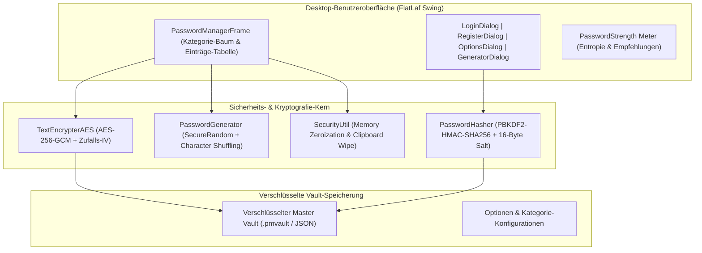

# 🔐 PasswordManager – Desktop Security Vault

[](https://openjdk.org/)
[](https://maven.apache.org/)
[](https://www.formdev.com/flatlaf/)
[](https://csrc.nist.gov/)
[](https://owasp.org/)
[](https://junit.org/junit5/)
[](LICENSE)

> 🌐 **Sprache / Language:** [🇩🇪 Zur deutschen Version](#-deutsche-dokumentation) | [🇬🇧 Switch to English Version](#-english-documentation)

---

## 🇩🇪 Deutsche Dokumentation

Ein sicherer, moderner Desktop-Passwortmanager auf Basis von **Java 17 LTS**, **FlatLaf Look & Feel**, authentifizierter **AES-256-GCM-Verschlüsselung**, **PBKDF2-Schlüsselableitung** (600.000 Runden) und **In-Memory-Zeroization**.

---

### 🎯 Sicherheits-Highlights & Architektur

- **Authentifizierte Verschlüsselung (AES-256-GCM):**
  Nutzt Galois/Counter Mode mit zufälligem 96-Bit (12-Byte) Initialisierungsvektor (IV) pro Eintrag und einem 128-Bit Authentifizierungstag zum Schutz vor Bit-Flipping und Manipulationen. Abwärtskompatibel zu älteren AES-Formaten.
- **NIST/BSI-konforme Schlüsselableitung (KDF):**
  Master-Keys werden über `PBKDF2WithHmacSHA256` mit 600.000 Iterationen und kryptografisch sicherem 16-Byte-Salt abgeleitet.
- **In-Memory Zeroization (Schutz vor RAM-Dumps):**
  Sensible Passwörter und Schlüssel-Arrays werden nach Benutzung direkt im Speicher genullt (`Arrays.fill(chars, '\0')`), um ein Auslesen aus dem Java-Heap zu verhindern.
- **Automatisches Leeren der Zwischenablage:**
  In die Zwischenablage kopierte Zugangsdaten werden nach 30 Sekunden durch einen Daemon-Thread automatisch gelöscht (Schutz vor Clipboard-Hijacking).
- **Kryptografischer Passwort-Generator:**
  Erzeugt sichere Kennwörter via `SecureRandom` mit garantierter Einbindung geforderter Zeichensätze und Entropie-Berechnung.
- **Moderne FlatLaf-Oberfläche:**
  High-DPI-fähige Desktop-GUI mit Dark/Light-Theme, Kategorien-Baumansicht und interaktiver Passwort-Stärke-Anzeige.

---

### 🏗️ Architektur & Komponenten-Flow



---

### 🚀 Schnellstart & Installation

#### Voraussetzungen
- **Java Development Kit (JDK):** 17 oder höher
- **Apache Maven:** 3.8 oder höher

#### 1. Kompilieren & Tests ausführen
```bash
git clone https://github.com/Tom7668h/PasswordManager.git
cd PasswordManager
mvn clean test
```
*Ergebnis: 26 von 26 Unit-Tests erfolgreich (100% grün).*

#### 2. Ausführbares Fat JAR erstellen
```bash
mvn package -DskipTests
```
Erzeugt `target/PasswordManager-1.0.0.jar` inklusive aller Abhängigkeiten.

#### 3. Anwendung starten
Per Doppelklick auf die JAR-Datei oder im Terminal:
```bash
java -jar target/PasswordManager-1.0.0.jar
```

---

### 🧪 Automatisierte Test-Suite (JUnit 5)

| Test-Klasse | Abdeckung & Validierung |
| :--- | :--- |
| **`TextEncrypterAESTest`** | AES-256-GCM Roundtrip, IV-Zufälligkeit, Abweisung falscher Schlüssel, Manipulationserkennung |
| **`PasswordHasherTest`** | SHA-256, SHA-512, MD5, PBKDF2-Salt-Generierung, zeitkonstante Hash-Verifikation |
| **`PasswordGeneratorTest`** | Längengarantien, Zeichensatz-Einbindung, Shuffle-Zufall, Reine-Ziffern-Modus |
| **`SecurityUtilTest`** | Shannon-Entropie, Schwach/Stark-Bewertung, Zeroization von Char/Byte-Arrays |
| **`PasswordEntryTest`** | Value-Object-Integrität, Copy-Konstruktor, equals & hashCode Verträge |

---

<br><br>

---

## 🇬🇧 English Documentation

An enterprise-grade, privacy-first desktop password manager built with **Java 17 LTS**, modern **FlatLaf Look & Feel**, authenticated **AES-256-GCM encryption**, **PBKDF2 key derivation** with 600,000 rounds, and **memory zeroization**.

---

### 🎯 Key Highlights & Security Architecture

- **Authenticated Encryption (AES-256-GCM):**
  Uses Galois/Counter Mode with a random 96-bit (12-byte) IV per entry and a 128-bit authentication tag. Protects against bit-flipping attacks and ciphertext tampering. Automatically backwards compatible with legacy AES formats.
- **NIST/BSI-Compliant Key Derivation:**
  Master keys are derived using `PBKDF2WithHmacSHA256` with 600,000 iterations and cryptographically secure 16-byte random salts.
- **In-Memory Zeroization (RAM Dump Protection):**
  Sensitive credentials and master keys are cleared in memory (`Arrays.fill(chars, '\0')`) to prevent sensitive data from lingering in Java heap memory.
- **Auto-Clearing System Clipboard:**
  Passwords copied to the operating system clipboard are automatically cleared after 30 seconds via scheduled daemon threads, preventing clipboard-snooping malware from harvesting credentials.
- **Cryptographic Password Generator:**
  Generates passphrases using `SecureRandom` with guaranteed presence of requested character sets (uppercase, lowercase, numbers, symbols) and entropy calculation.
- **Modern FlatLaf Dark UI:**
  Clean, high-DPI desktop experience with Dark/Light theme switching, categorized tree structure, and responsive tables.
- **Standalone Executable Fat JAR:**
  Packages all dependencies into a single runnable JAR via `maven-shade-plugin`.

---

### 🚀 Quickstart & Installation

#### Requirements
- **Java Development Kit (JDK):** 17 or higher
- **Apache Maven:** 3.8 or higher

#### 1. Build and Run Tests
```bash
git clone https://github.com/Tom7668h/PasswordManager.git
cd PasswordManager
mvn clean test
```

#### 2. Package Executable JAR
```bash
mvn package -DskipTests
java -jar target/PasswordManager-1.0.0.jar
```

---

### 📄 License
MIT License. Created by [Tom7668h](https://github.com/Tom7668h).
