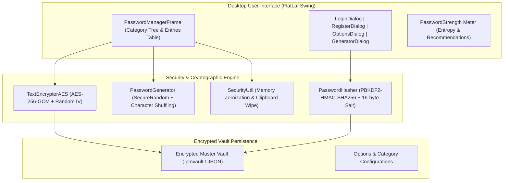

# 🛡️ PasswordManager • Desktop Security Vault

[](https://openjdk.org/)
[](https://maven.apache.org/)
[](https://www.formdev.com/flatlaf/)
[](https://csrc.nist.gov/)
[](https://owasp.org/)
[](https://junit.org/junit5/)
[](LICENSE)

An enterprise-grade, privacy-first desktop password manager built with **Java 17**, modern **FlatLaf Look & Feel**, authenticated **AES-256-GCM encryption**, **PBKDF2 key derivation** with 600,000 rounds, and **memory zeroization**.

---

## 🌟 Key Highlights & Security Architecture

- **Authenticated Encryption (AES-256-GCM):**
  Uses Galois/Counter Mode with a random 96-bit (12-byte) IV per entry and a 128-bit authentication tag. Protects against bit-flipping attacks and ciphertext tampering. Automatically backwards compatible with legacy AES formats.
- **NIST/BSI-Compliant Key Derivation:**
  Master keys are derived using `PBKDF2WithHmacSHA256` with 600,000 iterations and cryptographically secure 16-byte random salts.
- **In-Memory Zeroization (RAM Dump Protection):**
  Sensitive credentials and master keys are cleared in memory (`Arrays.fill(chars, '\0')`) to prevent sensitive data from lingering in Java heap memory.
- **Auto-Clearing System Clipboard:**
  Passwords copied to the operating system clipboard are automatically cleared after 30 seconds via scheduled daemon threads, preventing clipboard-snooping malware from harvesting credentials.
- **Cryptographic Password Generator:**
  Generates passphrases using `SecureRandom` with guaranteed presence of requested character sets (uppercase, lowercase, numbers, symbols) and entropy calculation.
- **Modern FlatLaf Dark UI:**
  Clean, high-DPI desktop experience with Dark/Light theme switching, categorized tree structure, and responsive tables.
- **Standalone Executable Fat JAR:**
  Packages all dependencies into a single runnable JAR via `maven-shade-plugin`.

---

## 🏗️ Architecture & Component Flow



---

## 🚀 Quickstart & Installation

### Requirements
- **Java Development Kit (JDK):** 17 or higher
- **Apache Maven:** 3.8 or higher

### 1. Build and Run Tests
```bash
git clone https://github.com/Tom7668h/PasswordManager.git
cd PasswordManager
mvn clean test
```
*Result: 26 out of 26 Unit Tests passed (100% green).*

### 2. Package Executable JAR
```bash
mvn package -DskipTests
```
This produces `target/PasswordManager-1.0.0.jar` with all dependencies bundled inside.

### 3. Launch Application
Double-click `target/PasswordManager-1.0.0.jar` or execute from terminal:
```bash
java -jar target/PasswordManager-1.0.0.jar
```

---

## 🧪 Automated Test Suite (JUnit 5)

| Test Suite | Coverage & Checks |
| :--- | :--- |
| **`TextEncrypterAESTest`** | AES-256-GCM roundtrip, random IV indistinguishability, wrong key rejection, ciphertext tamper detection |
| **`PasswordHasherTest`** | SHA-256, SHA-512, MD5, PBKDF2 salt generation, constant-time hash verification |
| **`PasswordGeneratorTest`** | Length guarantees, character set inclusion, shuffle randomness, digits-only mode |
| **`SecurityUtilTest`** | Shannon entropy calculations, weak/strong rating, char/byte array zeroization, token generation |
| **`PasswordEntryTest`** | Value object integrity, copy constructor, equals & hashCode contracts |

---

## 📄 License
MIT License. Created by [Tom7668h](https://github.com/Tom7668h).
